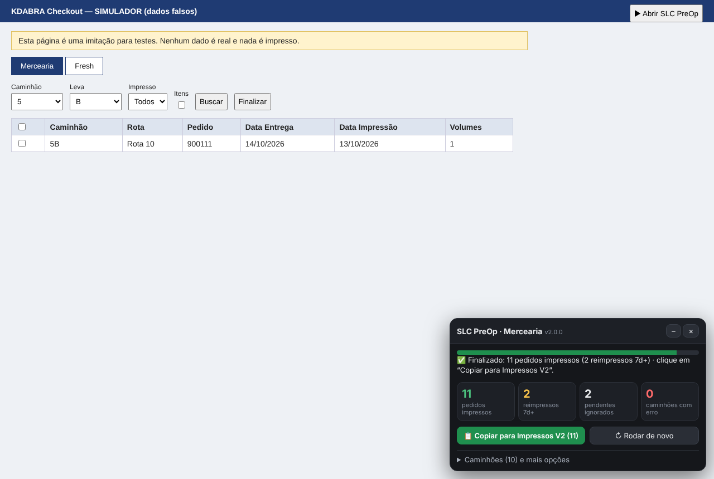

# SLC PreOp KDABRA — v2

Painel em JavaScript para a pré-operação do **KDABRA Checkout**, aberto por um favorito (bookmarklet) no navegador.



## Como usar

É igual à v1: **abra o KDABRA Checkout e clique no favorito Mercearia ou Fresh**. Ele faz tudo sozinho:

1. Lê **todos os caminhões** do filtro da tela, buscando só as **levas que cada caminhão usa** (1–99 → A/B, 100–149 → HA, 299 → A…Z e AA…AI etc.). Não testa as 32 levas em todo caminhão.
2. Imprime, na ordem de prioridade, os pedidos **não impressos** ou **impressos há 7 dias ou mais**.
3. Confere se o KDABRA registrou cada impressão.
4. Copia os pedidos impressos para a **Impressos V2**. No final aparece o aviso: é só abrir a planilha e apertar **Ctrl+V**.

Se a planilha não colar nada, clique em **📋 Copiar para Impressos V2** no painel. A última impressão fica guardada no navegador, então dá para copiar de novo mesmo depois de recarregar a página.

- **⏹ Parar** interrompe depois do caminhão atual, nunca no meio de um.
- **↻ Rodar de novo**, ou clicar no favorito outra vez, faz uma nova passada. O que já foi impresso não é impresso de novo.
- Em **Caminhões e mais opções** aparece a lista de caminhões com a situação de cada um (clique para ver os pedidos), além de Copiar resumo, Relatório CSV, Diagnóstico e Log.

Os favoritos estão em [`bookmarklets/`](bookmarklets/README.md). São os mesmos da v1, então quem já tem não precisa trocar.

## Regras

Detalhes em [`docs/regras-operacionais.md`](docs/regras-operacionais.md).

| | |
|---|---|
| Filtro | `Impresso = Todos` |
| Imprime | `Não foi impresso`, ou `Data Impressão` com **7 dias ou mais** |
| Ignora | `Pedido pendente`, impresso há menos de 7 dias, data inválida |
| Ordem | 299A → 299H → 100HA–124HA → demais 299 (B…Z, depois AA…AI) → A → B → C |
| Levas por caminhão | só as da faixa do caminhão (veja as regras); caminhão fora das faixas busca todas as levas |
| Caminhões novos | entram no fim do grupo da leva deles (A/H/KA → A, B/KB/NC → B, C → C) |
| Fora da fila | caminhões **3000 em diante** (nem são lidos) |

## Proteções

- **Tabela presa:** se a tabela não atualizar depois da busca (por exemplo, ainda mostrando o caminhão anterior), aquele caminhão é pulado, **nada dele é impresso** e o aviso final lista quais foram pulados.
- **Pedidos de outro caminhão:** só são marcadas linhas cuja coluna *Caminhão* bate com o que foi mapeado.
- **Marcação conferida:** antes de Finalizar, confere se a quantidade marcada na tela é exatamente a esperada.
- **Sem repetição:** um pedido impresso numa execução não é marcado de novo na mesma execução.
- **Uma instância só:** clicar no favorito de novo reabre o painel em vez de criar outro.

## Estrutura

```txt
src/slc-preop.js              ← código-fonte (o único arquivo que se edita)
src/mercearia.js, src/fresh.js ← gerados pelo build (os favoritos carregam estes)
scripts/build.js              ← gera os dois arquivos acima
test/logica.test.js           ← testes das regras
test/e2e.test.js              ← teste completo no navegador, usando o simulador
test/simulador/kdabra-falso.html ← imitação do KDABRA com dados falsos
bookmarklets/                 ← código dos favoritos
docs/                         ← regras, segurança, ideias futuras
```

## Desenvolvimento

```bash
npm install          # só na primeira vez
npm run build        # depois de editar src/slc-preop.js
npm test             # regras + confere se o build está atualizado
npm run test:e2e     # teste completo no Chromium, usando o simulador
```

Para testar à mão, abra `test/simulador/kdabra-falso.html` no navegador e clique em **▶ Abrir SLC PreOp**.

Para testar no KDABRA real **sem imprimir**, rode isto no console (F12) antes de clicar no favorito. Ele marca e confere os pedidos, mas não clica em Finalizar:

```js
window.SLC_PREOP_CONFIG = { simulacao: true }
```

### Quando o KDABRA mudar

Quase tudo fica no bloco `CONFIG` no topo de `src/slc-preop.js`:

- `seletores`: IDs dos filtros, da tabela e dos botões;
- `colunas`: nomes dos cabeçalhos da tabela (as colunas são achadas pelo nome, não pela posição);
- `levasPorCaminhao`: quais levas cada faixa de caminhão usa (se surgir um caminhão novo numa faixa nova, é aqui que se adiciona);
- `PRIORIDADES` e `foraDaFila`: ordem de impressão;
- `tempos`: esperas;
- `simulacao`: `true` marca e confere sem imprimir.

Se algo não for encontrado, o botão **🩺 Diagnóstico** copia a estrutura da tela, com todos os números trocados por 9, para ajudar a ajustar.

> ⚠️ Os favoritos carregam o código da branch `main`. Tudo que entra na `main` vale na hora para todo mundo que usa. Teste no simulador antes de fazer o merge.
